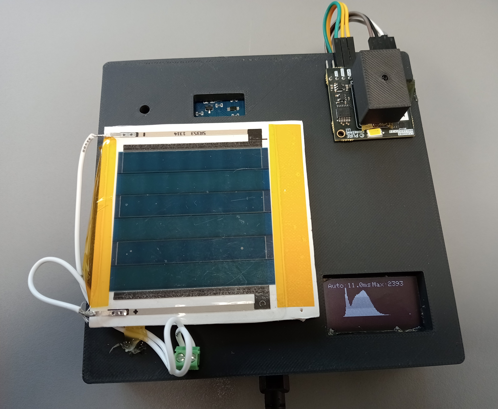
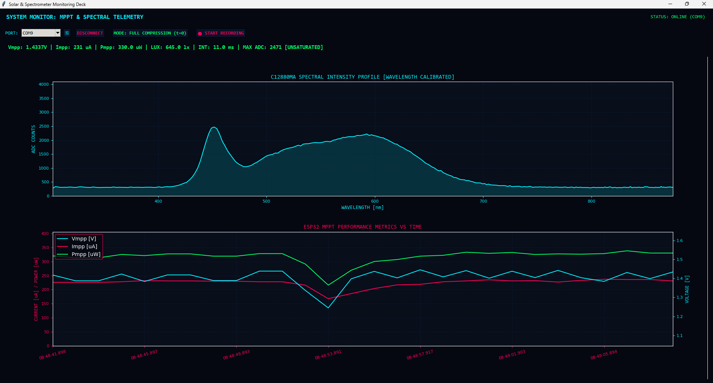

# Integrated Spectral Photovoltaic System


DOI: 10.5281/zenodo.17266828

[](https://www.espressif.com/)
[](https://www.python.org/)
[](LICENSE)

A high-performance embedded telemetry platform combining real-time **Maximum Power Point Tracking (MPPT)** for photovoltaic cells, **Hamamatsu C12880MA micro-spectrometer** optical characterisation, and comprehensive **environmental monitoring (BME680 TPH+Gas, GY-30 Lux)**. 

Designed for field research, solar characterisation, and optical optimisation, featuring dual-core ESP32 processing, on-chip polynomial wavelength calibration, SD card wear-levelled batch logging, and a real-time Tkinter/Matplotlib sci-fi telemetry dashboard.

---

##  System Overview & Hardware Gallery

### Hardware
<p align="center">
  
</p>
<p align="center">
  <em>Compact enclosure featuring ESP32, photovoltaic panel array, Hamamatsu C12880MA spectrometer, and SSD1306 OLED display.</em>
</p>

---

### Real-Time Python GUI Dashboard
<p align="center">
  
</p>
<p align="center">
  <em>Live multi-threaded monitoring interface showing calibrated spectral profile, V/I/P curves, and saturation flags.</em>
</p>

---

## Complete Hardware Pin Connections

All peripheral components interface directly with the **ESP32 NodeMCU (38-pin DevKit)**.

### 1. Hamamatsu C12880MA Micro-Spectrometer
| Spectrometer Pin | ESP32 GPIO Pin | Function / Description |
| :--- | :--- | :--- |
| **CLK** (Clock) | **GPIO 16** | Push-pull clock driver ($\text{Clock Period} = 2\,\mu\text{s}$) |
| **ST** (Start) | **GPIO 17** | Integration start trigger pulse |
| **VIDEO** (Analog Out) | **GPIO 34** | Analog video output (Configured on ADC1 Channel 6 with $6\,\text{dB}$ attenuation) |
| **3.3V / GND** | **3.3V / GND** | Regulated power supply and common ground |

### 2. I2C Sensor Bus (OLED, BME680, GY-30 Lux)
| I2C Bus Line | ESP32 GPIO Pin | Connected Peripherals |
| :--- | :--- | :--- |
| **SDA** (Data) | **GPIO 21** | SSD1306 OLED, BME680 TPH, GY-30 Lux (BH1750) |
| **SCL** (Clock) | **GPIO 22** | SSD1306 OLED, BME680 TPH, GY-30 Lux (BH1750) |

### 3. Micro-SD Card Module (SPI Interface)
| SD Card Pin | ESP32 SPI Pin | Function |
| :--- | :--- | :--- |
| **CS** (Chip Select) | **GPIO 5** | SPI Chip Select |
| **MOSI** | **GPIO 23** | Master Out Slave In |
| **MISO** | **GPIO 19** | Master In Slave Out |
| **SCK** | **GPIO 18** | SPI Serial Clock |

### 4. Power Electronics & MPPT Control
| Component | ESP32 Pin | Description |
| :--- | :--- | :--- |
| **PWM Gate Driver** | **GPIO 15** | PWM control signal for the MOSFET load ($1\,\text{kHz}$, $12$-bit resolution) |
| **INA226 Current/Voltage** | **I2C (21/22)** | High-side bidirectional bus voltage & shunt current sensor for MPPT loop |

---

##  Optical Calibration (Hamamatsu Serial: `21A02890`)

To eliminate post-processing overhead on host computers, the ESP32 performs on-chip nanometer conversion for all **288 individual pixels** using a factory-provided 5th-order polynomial equation:

$$\lambda(P) = A_0 + B_1 P + B_2 P^2 + B_3 P^3 + B_4 P^4 + B_5 P^5$$

### Calibration Coefficients:
* $A_0 = 3.02539467 \times 10^2$
* $B_1 = 2.70472314 \times 10^0$
* $B_2 = -1.10776346 \times 10^{-3}$
* $B_3 = -8.62290205 \times 10^{-6}$
* $B_4 = 1.42568072 \times 10^{-8}$
* $B_5 = -2.66396197 \times 10^{-12}$

---

##  Firmware Highlights (`Integrated_Spectral_PV5.ino`)

1. **Ultra-Fast Auto-Integration Loop**: Dynamically regulates spectrometer exposure time targeting an optimal mid-point count ($\sim 2100$ ADC counts), avoiding optical clipping plateaus ($\ge 2700$ counts).
2. **SD Card Wear-Leveling Buffer**: Gathers 1 sample per second into an internal RAM buffer (30 records) and flushes in a single batched file open/close cycle every 30 seconds to drastically minimize flash memory wear.
3. **Perturb & Observe (P&O) MPPT**: Tracks maximum solar power with adjustable duty cycle stepping, deadband filtering, and low-lux parking mode ($\le 50\,\text{lux}$).
4. **On-Chip Nanometer Mapping**: Converts pixel arrays to calibrated nanometers directly on the microcontroller before serial streaming or SD storage.

---

##  Python Telemetry Dashboard (`dashboard.py`)

A multi-threaded Tkinter and Matplotlib monitoring deck featuring:
* **Live Serial Streaming**: Parses high-frequency telemetry packets from the ESP32 at $115200\,\text{baud}$.
* **Dynamic Saturation Highlighting**: Automatically detects optical clipping ($\text{Max ADC} \ge 2700$) and color-codes the telemetry readout (**Bright Green** for `UNSATURATED`, **Bright Red** for `SATURATED`).
* **Dual Time Modes**: Toggle between **Rolling Window** (fixed time span) and **Full Compression** ($t=0$ timeline view).
* **CSV Export**: Direct recording interface to save complete atmospheric, optical, and photovoltaic sweeps.

### CSV Telemetry Protocol Format:
```csv
RecordType,Timestamp,Voltage_V,Current_A,Power_W,DutyCycle,Temp_C,Pressure_hPa,Humidity_perc,Gas_Ohm,Lux,IntegrationTime_us,Max_ADC,Saturation_Status,[288 Wavelength columns in nm...]


